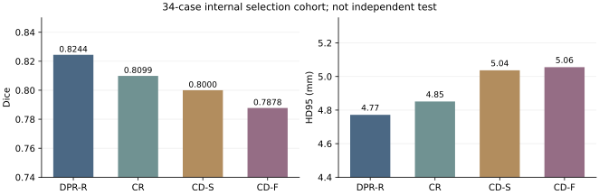

# 双视角腰椎重建中的条件扩散实验

这个仓库记录从双视角 DRR 与标定矩阵重建 L1–L5 三维标签的一组实验。
内容包括核心模型／采样实现、实验脉络、修订后的发现和机器可读汇总结果。
当前定位是**经验比较与失效分析**，已有结果没有证明扩散优于强确定性参考。
这是一份供审核的精简研究快照，不是完整私人工程或可一键复现全部历史的发布包。

[English overview](README.en.md) · [实验过程](docs/EXPERIMENTS.md) ·
[发现与边界](docs/FINDINGS.md) · [复现范围](docs/REPRODUCIBILITY.md) ·
[数据和隐私](docs/DATA_AND_PRIVACY.md)

## 最终条件比较

795 例训练、34 例内部选择；34 例长期参与开发和选点，不能当独立测试。
扩散每患者分别采样 5 次，先平均指标，再在患者间平均；没有 GT 挑样本。

| 方法 | 定义 | Dice | HD95 mm |
| --- | --- | ---: | ---: |
| DPR-R | 既有确定性潜回归，随后硬标签重编码 | 0.8244 | 4.77 |
| CR | 同条件确定性回归 | 0.8099 | 4.85 |
| CD-S | 同条件拓扑，从零扩散训练 | 0.8000 | 5.04 |
| CD-F | 冻结独立先验，训练条件分支 | 0.7878 | 5.06 |

四者漏检为 0。历史 DPR-R 与三臂的容量、损失和训练预算不同，表格是策略比较。
三臂各 150k 更新；最佳点分别为 CR 10k、CD-S 30k、CD-F 70k。



## 已有发现

- **先验生成与患者重建需要分别验证。** 独立先验的 DDPM1000 内部生成筛查通过，
  条件重建的质量条件仍未通过。
- **当前联合条件有效。** CD-F 正确 image+matrix 相对固定供体平均高 0.2436 Dice。
  这不能单独证明影像灰度或几何各自的贡献。
- **AE 并非已证实的灾难性瓶颈。** 34 例真值往返 Dice 为 0.9557。
  固定偏置附近的敏感性不代表所有生成潜码的敏感性。
- **对齐是具体误差线索。** 真值辅助平移和固定 seed0 刚体诊断分别缩小方法差距
  36.8% 和 62.0%；这些是不可部署的误差诊断，不是因果归因份额。

所有结论限于本项目数据、实现和预算；没有证明“扩散普遍无效”或“先验本身有害”。
105 例封存测试尚未用于最终验证，训练重复和预训练后全参数微调未完成。

## 快速检查

在 Python 3.10 或更新版本环境中，按设备安装合适的 PyTorch 后：

```bash
pip install -r requirements.txt
python scripts/privacy_audit.py
python scripts/smoke.py
python -m unittest discover -s tests -v
python scripts/summarize_results.py
```

合成检查不需要真实数据、权重、GPU、网络或账户。新产生的玩具数组不是医学样本。
首版提供可导入的训练目标与核心网络，不包含原项目的训练调度和全部预处理驱动。

## 仓库内容

- `src/lumbar_diffusion/`：AE、几何提升、确定性／条件模型、DDPM/DDIM、历史桥过程。
- `configs/`：历史预算、形状和输入契约，**不是新实验授权**。
- `data/aggregate/`：4 种方法成绩、45 个选点、汇总诊断和先验比较。
- `docs/`：实验顺序、纠错记录、可复现范围、数据来源与引用。
- `scripts/`、`tests/`：合成检查、汇总复算与上传前的隐私检查。
- `code_provenance.json`：源码符号来源；`release_manifest.json`：允许上传的文件及校验值。

## 数据获取和发布状态

本仓库只含汇总统计和合成检查代码。真实 DRR、CT、标签、逐例结果、原病例编号、
潜编码、权重、原始日志和论文文档均未放入。PPCNet 数据应通过
[官方页面](https://huggingface.co/datasets/ppcnet-dataset/PPCNet) 申请，
并遵守 [数据许可](https://huggingface.co/datasets/ppcnet-dataset/PPCNet/blob/main/LICENSE)。
当前公开数据卡与本地历史版本的分辨率差异仍需核实，不能假定下载后直接兼容。

本版先用于私有审核，尚未指定开源许可。公开前应确认权利归属和
[发布边界](LICENSE_STATUS.md)。未在本仓库声明作者身份、机构或联系方式。
